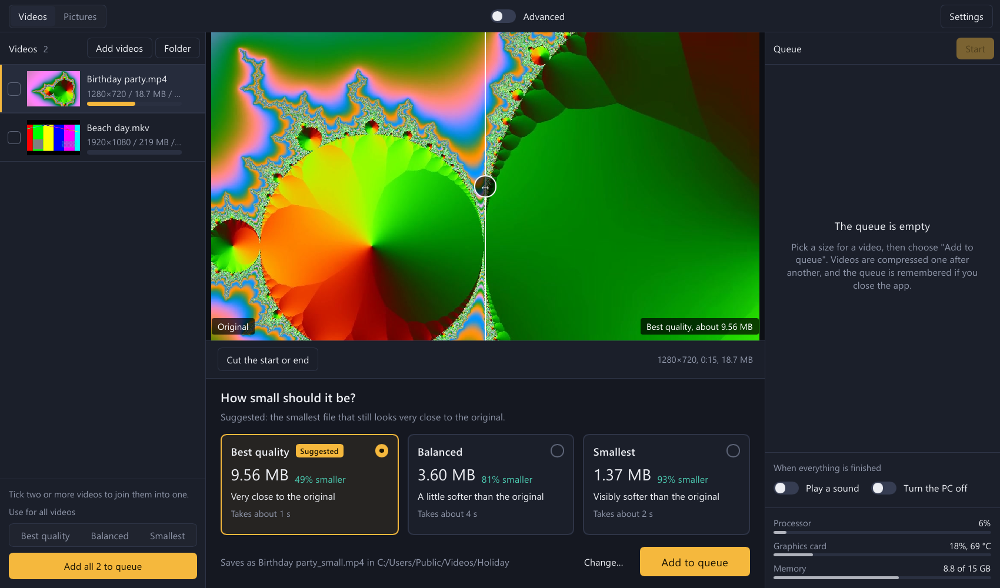

# Make Video Small

A Windows app that makes videos and pictures smaller. Add a file, and the app tries three sizes on it, shows what each one looks like next to the original, and suggests one. Everything runs on your own PC; nothing is uploaded.



## What it does

**Videos**

- **Three choices, measured on your video.** Best quality, Balanced and Smallest each show the size the file will become, how much smaller that is, how it will look and how long it takes. One is marked as suggested.
- **See it before you commit.** The original and the chosen size play side by side with a divider you can drag.
- **Cut the start or end** to keep only part of a video.
- **Join several videos into one.** Tick them in the order they should play.
- **Black bars are removed automatically** when a video has them.
- **A queue** that works through your files one after another. You can reorder, pause, resume and cancel, and it is remembered if the app closes.
- **Uses your graphics card when it can** (NVIDIA, AMD or Intel), which is several times faster. One setting switches to the smallest possible files instead.
- **Advanced controls** behind one switch: exact encoder (H.264, HEVC, AV1), quality, bitrate or target file size, two-pass, resolution, frame rate, crop, 10-bit, HDR, each audio and subtitle track, filters, and your own saved presets.

**Pictures**

- **Make smaller** as WebP, JPEG, AVIF or PNG.
- **Fit a size limit**, for upload forms that reject large files.
- **Crop** by dragging a box, free or to a fixed shape.
- **Remove the background** so only the subject is left.
- **Make bigger** four times with AI (needs a graphics card).

Originals are never changed or overwritten. Camera details and GPS location are never copied into picture results.

## Install

1. Open the [Releases page](https://github.com/ghostofweb/makevideosmall/releases).
2. Download the latest `Make Video Small_x.y.z_x64-setup.exe`.
3. Run it.

Windows 10 or 11, 64-bit.

## How it is built

| Part | What |
|---|---|
| Window | [Tauri 2](https://tauri.app) with the system WebView2 |
| Interface | React 19, TypeScript, Tailwind CSS, Radix UI (`src/`) |
| Core | Rust (`src-tauri/`): reading files, building ffmpeg commands, the queue, presets, analysis, picture tools |
| Media engine | [ffmpeg](https://ffmpeg.org) and ffprobe, run as separate programs |
| AI | [Real-ESRGAN](https://github.com/xinntao/Real-ESRGAN-ncnn-vulkan) for enlarging; a U²-Net model through ONNX Runtime for background removal |

The Rust core owns all state. The interface only shows it and sends commands. TypeScript types are generated from the Rust structs, so the two cannot drift apart.

```
src/                 interface
  app/               window frame, start-up
  features/          sources, editor (simple + advanced), preview, queue, image, settings, presets
  stores/            state mirrored from the core
  lib/               typed bridge to Rust, formatting and maths helpers (unit-tested)
  bindings/          generated from Rust: do not edit
src-tauri/src/       core
  ffmpeg/            locate, probe, capabilities, command builder, progress parser, process runner
  queue.rs           ordering, pause/resume/cancel, persistence
  analysis.rs        black bars, noise, size estimates, the three choices and the suggestion
  image.rs           compress, fit a size, crop, enlarge
  background.rs      background removal
  presets.rs         built-in and saved presets, the simple choices
  app.rs             the commands the interface can call
engine/              bundled tools and AI models
e2e/                 drives the real window end to end
```

## Development

You need [Node.js](https://nodejs.org) 20 or newer, [Rust](https://rustup.rs) and the Microsoft C++ Build Tools ("Desktop development with C++").

```bash
git clone https://github.com/ghostofweb/makevideosmall.git
cd makevideosmall
npm install
npm run fetch-ffmpeg   # downloads ffmpeg + ffprobe into engine/ (not stored in git)
npm run dev            # run the app with live reload
```

If you skip `fetch-ffmpeg`, the app uses an ffmpeg found on your `PATH`.

| Command | What it does |
|---|---|
| `npm run dev` | Run the app in development |
| `npm run build` | Build the app and the installer (`src-tauri/target/release/bundle/nsis`) |
| `npm run typecheck` / `npm run lint` | Check the interface code |
| `npm test` | Interface unit tests |
| `npm run test:rust` | Core unit tests, plus tests that run real encodes through ffmpeg and check the results |
| `npm run bindings` | Regenerate `src/bindings` after changing Rust types |
| `node e2e/run.mjs <empty folder>` | Click through the built app and verify every output file |

After `npm run test:rust`, rebuild the app (`npx tauri build --debug --no-bundle`) before running the end-to-end script: the test build replaces the app binary with one that expects the development server.

### Releasing

Updates are delivered through GitHub Releases and are signed. Building a release needs the private signing key in `TAURI_SIGNING_PRIVATE_KEY`; the matching public key is in `src-tauri/tauri.conf.json`. Upload the installer, its `.sig` file and `latest.json` to the release.

## Licences

The app's own code is under the licence in `license.txt`. It bundles and runs third-party software under their own licences: ffmpeg (GPL build), Real-ESRGAN ncnn Vulkan (MIT), ONNX Runtime (MIT) and the U²-Net model from [rembg](https://github.com/danielgatis/rembg) (MIT; model weights Apache-2.0).
